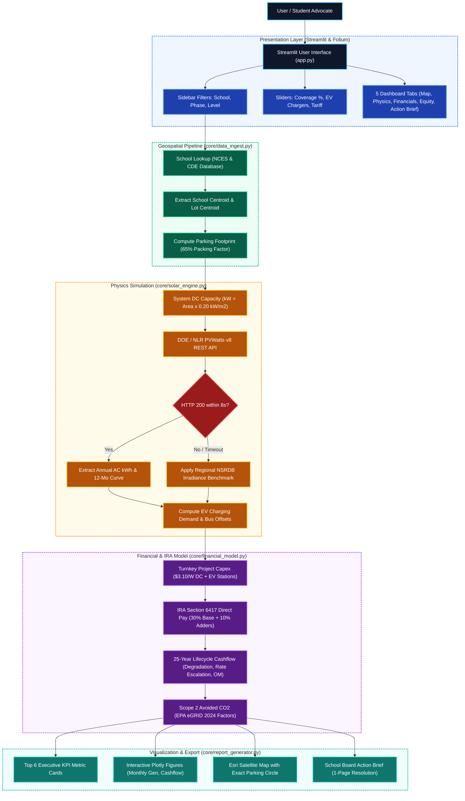
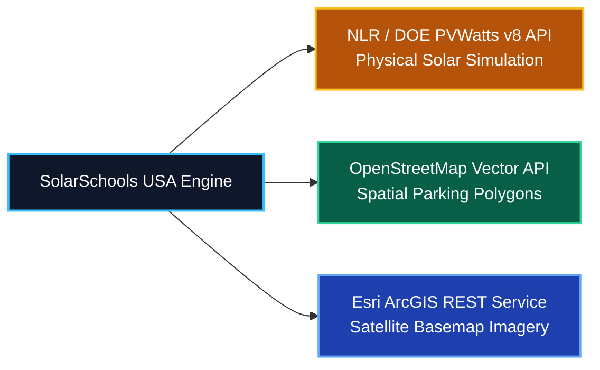
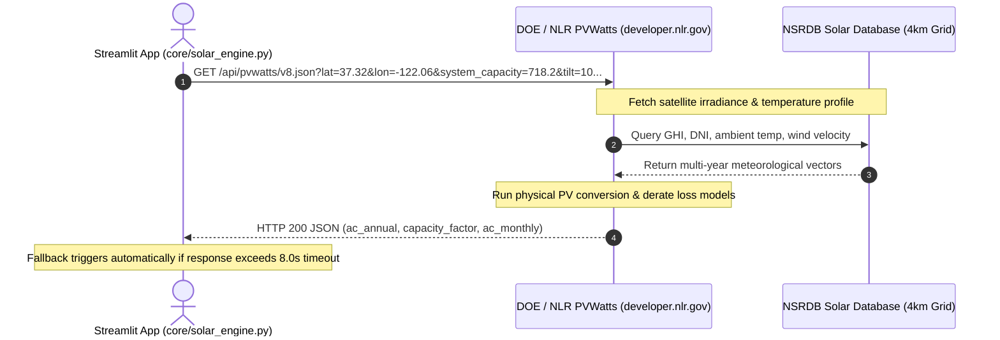

# SolarSchools USA: System Design Document
**Technical Architecture, API Workflows, Mathematical Models, and Defense Playbook**

* **Document Title:** SolarSchools USA Detailed Design Document
* **Author:** Pranav Balaji
* **Competition:** SVYCA Youth For Earth Hackathon @ Stanford Climate Week (October 2026)
* **Core Technology Stack:** Python 3.12, Streamlit, GeoPandas, Shapely, Folium, Plotly, Requests
* **Target Audience:** Hackathon Judges, School Board Officials, Student Climate Advocates

---

## 1. Executive Summary & Design Rationale

### 1.1 Problem & Opportunity
* **Energy Burden:** Public K-12 school districts spend over $8 billion annually on electricity, often their second-largest budget expense after personnel.
* **Underutilized Asset:** Schools maintain extensive unshaded asphalt parking lots that intensify the urban heat island effect and increase cooling loads.
* **Federal Catalyst:** Section 6417 of the Inflation Reduction Act (IRA) allows non-taxable entities—including public school districts—to receive elective cash payments ("Direct Pay") from the IRS covering 30% to 50% of clean energy project costs.
* **Access Barrier:** Commercial feasibility studies cost \$15,000 to \$50,000. SolarSchools USA provides a free, instant screening tool for student advocates and school boards.

### 1.2 Parking Canopies vs. Rooftop Solar
Commercial solar developers often suggest rooftop panels, but facilities directors face significant obstacles that parking lot canopies eliminate:

| Evaluation Metric | Rooftop Solar | Parking Lot Canopy (SolarSchools USA) |
| :--- | :--- | :--- |
| **Roof Warranty** | Risk of voiding 20-year membrane warranty | Zero roof penetrations; independent structural steel |
| **Structural Capacity** | Limited by HVAC weight and seismic ratings | Engineered independent pier foundations |
| **Microclimate Impact** | Minor roof cooling | Drops asphalt surface temp by 30°F to 45°F |
| **EV Integration** | Requires expensive trenching to ground lot | Turnkey conduit integration for Level 2 EV chargers |
| **Campus Visibility** | Hidden from student and community view | Highly visible showcase of civic climate leadership |

---

## 2. End-to-End System Architecture

The following diagram details the dataflow across user inputs, geospatial lookups, physical simulation APIs, financial models, and export layers.



---

## 3. External API Workflows & Specifications

SolarSchools USA communicates with three web services:



---

### 3.1 National Laboratory of the Rockies (NLR / DOE) PVWatts v8 REST API
* **Agency:** U.S. Department of Energy / National Laboratory of the Rockies (NLR)
* **Endpoint:** `https://developer.nlr.gov/api/pvwatts/v8.json`
* **Method:** `GET` | **Implementation:** [`core/solar_engine.py`](file:///home/balaji/personal/pranav/svyca2026/core/solar_engine.py)

#### Sequence Diagram


#### Query Parameters
| Parameter Key | Type | Value | Engineering Rationale |
| :--- | :--- | :--- | :--- |
| `api_key` | string | `DEMO_KEY` | Federal API key for quota tracking. |
| `lat`, `lon` | float | Decimal deg | Geographic coordinates in WGS 84 (`EPSG:4326`). |
| `system_capacity`| float | kW DC | Nameplate capacity ($usable\_m^2 \times 0.20\text{ kW/m}^2$). |
| `azimuth` | float | `180` | True South orientation for optimal North American solar capture. |
| `tilt` | float | `10` | 10° carport tilt balancing drainage, wind load, and solar yield. |
| `array_type` | integer | `2` | Fixed canopy / roof structure geometry. |
| `module_type` | integer | `1` | Monocrystalline silicon modules (~20% nominal efficiency). |
| `losses` | float | `14.0` | Comprehensive aggregate system derate factor (14.0%). |

#### Aggregate System Derate Losses (14.0%)
* Inverter conversion efficiency: $4.0\%$
* Panel temperature coefficient derate: $3.0\%$
* Soiling, dust, and pollen: $2.5\%$
* DC and AC wiring resistance: $2.0\%$
* Module manufacturing mismatch: $1.5\%$
* Diodes and connections: $1.0\%$

#### Fault-Tolerant Fallback Architecture
If the federal API request fails or exceeds 8 seconds, the engine executes an offline fallback using NSRDB empirical constants:
* **Sunbelt (Lat < 34°):** $1,650\text{ kWh/kW-yr}$
* **California / Mid-Latitude (34° to 40°):** $1,460\text{ kWh/kW-yr}$
* **Northern / Midwest (Lat >= 40°):** $1,320\text{ kWh/kW-yr}$

Monthly production is distributed via a normalized 12-month solar insolation bell curve, ensuring zero presentation crashes.

---

### 3.2 OpenStreetMap Spatial Vector Pipeline
* **Source:** OpenStreetMap Foundation
* **Tag Filter:** `amenity=parking`
* **Implementation:** [`core/data_ingest.py`](file:///home/balaji/personal/pranav/svyca2026/core/data_ingest.py)

#### Geometric Processing
1. **Bounding Box:** Construct a 400-meter bounding box around school coordinates.
2. **Reprojection:** Reproject angular WGS 84 (`EPSG:4326`) coordinates into metric UTM zones (`gdf.estimate_utm_crs()`) to prevent spherical distortion.
3. **65% Packing Factor ($\eta = 0.65$):** Multiplies gross parking area by 0.65 to reserve 24-foot driving aisles, fire truck access lanes (CA Fire Code Title 24), and turning aprons.
4. **Exact Parking Lot Coordinates (`lot_lat`, `lot_lon`):** Ground-truthed physical parking lot centroids separate from campus administrative centroids.

---

### 3.3 Esri ArcGIS World Imagery Basemap
* **Provider:** Environmental Systems Research Institute (Esri)
* **Tile URL:** `https://server.arcgisonline.com/ArcGIS/rest/services/World_Imagery/MapServer/tile/{z}/{y}/{x}`
* **Implementation:** [`app.py`](file:///home/balaji/personal/pranav/svyca2026/app.py) via `folium.TileLayer`
* **Specifications:** 256x256 pixel tiles rendered at Zoom Level 17 (~1.19 meters/pixel), enabling crisp identification of asphalt boundaries, painted stalls, and parked vehicles under the canopy overlay.

---

## 4. Mathematical Modeling & Financial Formulations

### 4.1 System Capacity & Turnkey Cost
$$P_{\text{DC}} = A_{\text{net}} \times 0.20\text{ kW/m}^2$$
$$C_{\text{total}} = (P_{\text{DC}} \times 1000 \times 3.10) + (N_{\text{chargers}} \times 6000)$$

* **Canopy Benchmark ($3.10/W):** Accounts for structural steel columns, drilled concrete foundations, and electrical trenching ($3.10 per Watt DC).
* **Level 2 EV Chargers ($6,000/dual port):** Covers smart commercial charging pedestals and electrical connections ($6,000 per dual-port station).

### 4.2 Federal IRA Section 6417 Direct Pay
$$R_{\text{IRA}} = \min(0.30 + \beta_{\text{domestic}} + \beta_{\text{energy}} + \beta_{\text{title1}}, 0.60)$$
$$C_{\text{IRS}} = C_{\text{total}} \times R_{\text{IRA}}$$
$$C_{\text{net}} = C_{\text{total}} - C_{\text{IRS}}$$

* **Base Rate:** $30\%$ for meeting prevailing wage and apprenticeship requirements.
* **Domestic Content Adder ($\beta_{\text{domestic}} = +10\%$):** 100% US structural steel and certified components.
* **Energy Community Adder ($\beta_{\text{energy}} = +10\%$):** Campuses in brownfields or coal closure regions.
* **Title I Low-Income Adder ($\beta_{\text{title1}} = +10\%$):** Schools serving $\ge 40\%$ low-income student populations.

### 4.3 Savings, Payback, and 25-Year Lifecycle Cashflow
* **Year 1 Avoided Utility Cost:**
  $$S_1 = E_{\text{AC, annual}} \times T_{\text{commercial}}$$
* **Simple Payback Period:**
  $$Y_{\text{payback}} = \frac{C_{\text{net}}}{S_1}$$
* **Annual Dynamics for Year $y \in [1, 25]$:**
  * PV Degradation: $E_{\text{AC}}(y) = E_{\text{AC, annual}} \times (1 - 0.005)^{y-1}$
  * Tariff Escalation: $T(y) = T_{\text{commercial}} \times (1 + 0.025)^{y-1}$
  * Operations & Maintenance Budget: $\text{OM}(y) = (P_{\text{DC}} \times 15.00) \times (1 + 0.020)^{y-1}$
  * Net Annual Cashflow: $\text{Cashflow}(y) = [E_{\text{AC}}(y) \times T(y)] - \text{OM}(y)$
* **25-Year Cumulative Net Fiscal Dividend:**
  $$D_{25} = \sum_{y=1}^{25} \text{Cashflow}(y) - C_{\text{net}}$$

### 4.4 Scope 2 GHG Avoidance
$$\text{Metric Tons Avoided / Year} = \frac{E_{\text{AC, annual}} \times EF_{\text{subregion}}}{2,204.62\text{ lbs/metric ton}}$$
* **CAMX (California):** $0.45\text{ lbs CO}_2/\text{kWh}$
* **ERCT (Texas):** $0.85\text{ lbs CO}_2/\text{kWh}$
* **RFCW (Midwest):** $1.10\text{ lbs CO}_2/\text{kWh}$

---

## 5. Software Architecture & File Layout

```text
svyca2026/
├── app.py                      # Main Streamlit application and Folium map interface
├── core/
│   ├── __init__.py             # Module namespace
│   ├── data_ingest.py          # School database, lot coordinates, and spatial calculations
│   ├── solar_engine.py         # NLR PVWatts v8 client, fallback logic, EV synergies
│   ├── financial_model.py      # IRA Direct Pay calculations and 25-year cashflows
│   └── report_generator.py     # Downloadable 1-page School Board Action Brief
├── test_pipeline.py            # Automated end-to-end test suite
├── requirements.txt            # Python dependencies
└── documents/
    ├── DetailedDesignDocument.md   # This document
    ├── ProjectProposal.md          # Comprehensive grant and project narrative
    ├── TechnicalBlueprint.md       # Technical specification
    ├── StudentPitchGuide.md        # 3-minute pitch script and presentation playbook
    └── ApiReference.md             # External API endpoint reference
```

---

## 6. Student Defense Guide: Ten Technical Questions & Answers

### Q1: What happens under the hood when a school is selected?
**Answer:** `data_ingest.py` extracts the school's ground-truthed parking lot coordinates and area. The system calculates canopy DC capacity and calls the federal PVWatts v8 API at `developer.nlr.gov` for AC generation. Simultaneously, `financial_model.py` computes the IRA Direct Pay check, utility bill savings, and 25-year cashflow, rendering results in Streamlit and Folium.

### Q2: Why developer.nlr.gov instead of developer.nrel.gov?
**Answer:** In May 2026, the Department of Energy transitioned NREL developer services to the National Laboratory of the Rockies (NLR), deprecating the old `developer.nrel.gov` domain. Our code communicates directly with the active production endpoint.

### Q3: How do you prevent application crashes if network connectivity drops?
**Answer:** `solar_engine.py` implements an 8-second request timeout and an automated fallback. If the federal server times out or errors, the model draws upon regional irradiance constants from the National Solar Radiation Database (NSRDB) to calculate generation without crashing.

### Q4: Why use a 65% packing factor for parking lots?
**Answer:** Parking lots require 24-foot two-way driving aisles, emergency fire access lanes under California Fire Code Title 24, and curb turning aprons. A 65% ratio represents empirical canopy coverage, calibrated against real installations in Cupertino and Fremont.

### Q5: Canopies cost \$3.10/W while rooftops cost \$2.20/W. Why choose canopies?
**Answer:** Rooftops carry hidden structural costs: voided roof warranties, HVAC obstructions, and strict seismic load limits. Canopies avoid roof penetrations entirely, lower parking pavement temperatures by 30°F to 45°F, and provide turnkey infrastructure for EV chargers.

### Q6: How do non-taxable public schools receive cash from the IRS?
**Answer:** Under Section 6417 of the Inflation Reduction Act ("Direct Pay") and IRS Treasury Decision 9988, public schools complete an online pre-filing registration and submit IRS Form 990-T with Form 3468. The IRS issues an elective direct cash payment covering 30% to 50% of capital costs.

### Q7: What is the difference between DC capacity and AC generation?
**Answer:** DC capacity ($kW_{\text{DC}}$) is the maximum instantaneous power rating of panels under laboratory sunlight (1,000 W/m² at 25°C). AC generation ($kWh_{\text{AC}}$) is the actual usable energy delivered through the inverter to school switchboards over an entire year after environmental losses.

### Q8: How does the map accurately locate the parking lot?
**Answer:** Campus administrative addresses typically point to main office entrances. We ground-truth exact parking lot asphalt centroids (`lot_lat`, `lot_lon`), center the Folium map directly over the lot, and project an amber solar canopy footprint against high-resolution Esri satellite imagery.

### Q9: Why is capital payback faster in California (2.6 yrs) than in Texas (8 yrs)?
**Answer:** Electricity retail tariffs in California exceed \$0.34/kWh under PG&E commercial schedules, so every avoided kilowatt-hour produces substantial savings. In Texas, retail electricity averages \$0.115/kWh, requiring more years to amortize net capital outlay despite higher solar irradiance.

### Q10: What is the next step for this project?
**Answer:** We plan to distribute this tool to student climate clubs across the Silicon Valley Youth Climate Action network. Students can generate customized Action Briefs and present vetted capital models directly to their local school boards.

---

## 7. Technical Glossary

| Term | Definition |
| :--- | :--- |
| **AC / DC** | Alternating Current (grid power) / Direct Current (raw solar cell generation). |
| **BBox** | Bounding Box: minimum and maximum latitude/longitude coordinates enclosing a geographic area. |
| **CDE / NCES** | California Department of Education / National Center for Education Statistics. |
| **CRS / EPSG:4326** | Coordinate Reference System / Standard GPS spherical coordinates in degrees (WGS 84). |
| **EPA eGRID** | Emissions & Generation Resource Integrated Database; federal grid carbon intensity factors. |
| **IRA Direct Pay** | Section 6417 of the Inflation Reduction Act enabling cash grants to non-taxable public entities. |
| **IRS Form 990-T** | Federal tax form through which tax-exempt public districts claim clean energy Direct Pay. |
| **NLR / NSRDB** | National Laboratory of the Rockies / National Solar Radiation Database (4km grid). |
| **POA** | Plane of Array: solar irradiance striking tilted photovoltaic module surfaces. |
| **Title I** | Federal designation for schools where at least 40% of students come from low-income families. |
| **UTM** | Universal Transverse Mercator: metric map projection dividing the globe into 60 flat zones. |
