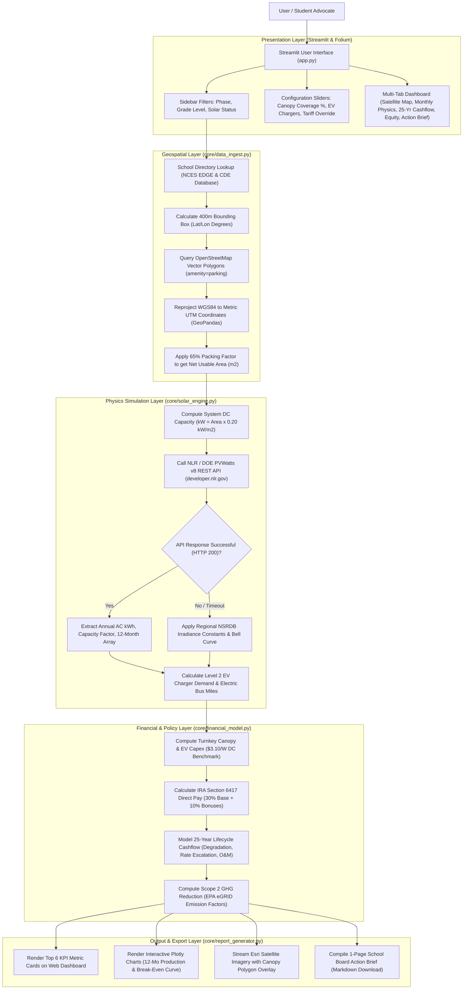
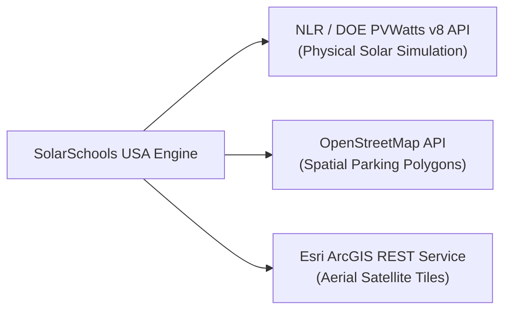
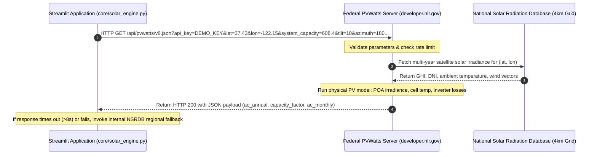
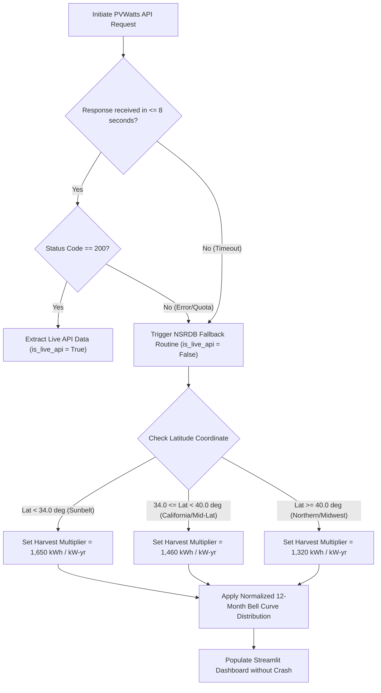
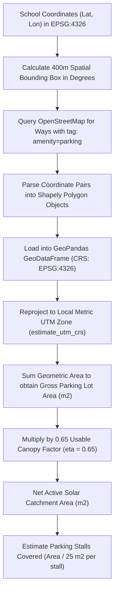
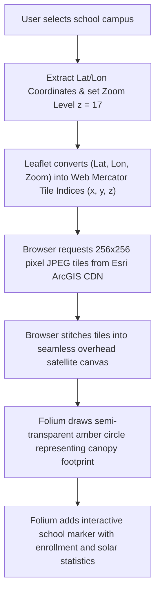
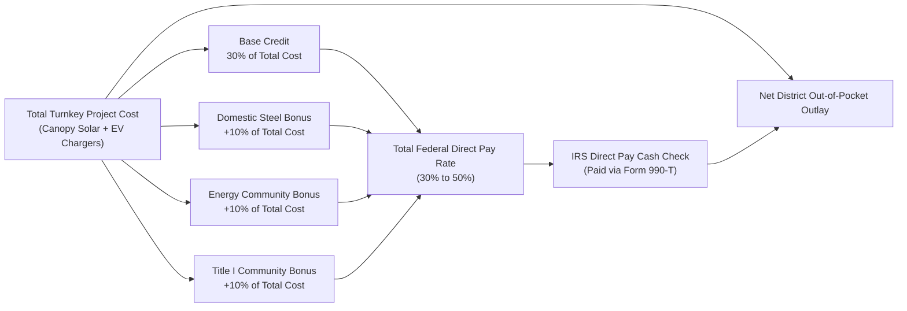

# SolarSchools USA: Detailed System Design Document
**Technical Architecture, API Workflows, Mathematical Models, and Defense Playbook**

* **Document Title:** SolarSchools USA Detailed Design Document
* **Author:** Pranav Balaji
* **Competition:** SVYCA Youth For Earth Hackathon @ Stanford Climate Week (October 2026)
* **Core Technology Stack:** Python 3.12, Streamlit, GeoPandas, Shapely, Folium, Plotly, Requests
* **Target Audience:** Hackathon Judges, School Board Officials, Student Climate Advocates

---

## 1. Executive Summary & Design Philosophy

### 1.1 Problem Statement
Public school districts in the United States spend more than $8 billion each year on electricity. For most districts, energy is their second-largest operating expense after teacher salaries. At the same time, thousands of campuses dedicate acres of valuable land to unshaded asphalt parking lots and blacktop courtyards that absorb solar radiation and drive up air-conditioning bills.

While rooftop solar installations often confront serious structural impediments (including roof structural weight limits, seismic bracing mandates, HVAC obstruction, and voided 20-year roof warranties), parking lot solar canopies offer:
1. Flat, pre-graded, unshaded solar geometry.
2. Direct shade that reduces vehicle cabin temperatures and drops pavement heat by 30°F to 45°F.
3. Turnkey physical infrastructure for Level 2 EV charging for faculty and future electric school buses.

Crucially, Section 6417 of the federal Inflation Reduction Act of 2022 (IRA) established Elective Pay (commonly known as Direct Pay). Under this provision, tax-exempt public school districts receive direct cash reimbursement checks from the Internal Revenue Service (IRS) covering 30% to 50% of the total installed project cost. Despite this federal capital injection, over 90% of school boards lack the tools to assess feasibility without paying thousands of dollars to private commercial solar developers.

### 1.2 Architectural Philosophy
SolarSchools USA was engineered around three strict design principles:
1. **Decoupled Modular Architecture:** Data ingestion, solar physics simulation, financial modeling, and report compilation are isolated in separate Python modules (`core/`) so that any component can be modified or tested independently.
2. **Defensive Fault Tolerance:** External federal API calls to the National Laboratory of the Rockies (NLR) are protected by strict timeout thresholds (8 seconds) and automated fallback algorithms based on the National Solar Radiation Database (NSRDB). The application will never crash during a live presentation if the network drops.
3. **Calibrated Local Ground-Truthing:** Spatial packing factors ($65\%$) and regional yields were calibrated against real completed installations in Silicon Valley, specifically Cupertino Union School District's (CUSD) 5.2 MW rollout and Fremont Union High School District's (FUHSD) Monta Vista High solar carports.

---

## 2. End-to-End System Architecture

The following diagram illustrates how user input travels through the presentation layer, triggers geospatial transformations, queries external REST APIs, computes federal tax incentives, and compiles downloadable board resolutions.



---

## 3. Detailed API Workflows & Specifications

SolarSchools USA communicates with three external web services:



---

### 3.1 Service 1: National Laboratory of the Rockies (NLR / DOE) PVWatts v8 REST API

* **Operating Agency:** National Laboratory of the Rockies (NLR / formerly NREL), U.S. Department of Energy
* **Production Endpoint:** `https://developer.nlr.gov/api/pvwatts/v8.json`
* **HTTP Method:** `GET`
* **Implementation File:** [`core/solar_engine.py`](./core/solar_engine.py)

#### Detailed Sequence & Execution Dataflow


#### Complete Query Parameters

| Parameter Key | Data Type | Production Value | Physical Definition & Engineering Rationale |
| :--- | :--- | :--- | :--- |
| `api_key` | string | `DEMO_KEY` (or custom) | Federal developer authentication key for query quota tracking. |
| `lat` | float | e.g. `37.4358` | Latitude in decimal degrees (WGS 84 coordinate reference system). |
| `lon` | float | e.g. `-122.1553` | Longitude in decimal degrees (WGS 84 coordinate reference system). |
| `system_capacity` | float | e.g. `608.4` | Nameplate DC system capacity in kilowatts (kW DC). |
| `azimuth` | float | `180` | Orientation angle in degrees. $180^\circ$ corresponds to True South, capturing maximum diurnal solar insolation in North America. |
| `tilt` | float | `10` | Array inclination angle in degrees. Standard commercial carports are engineered at a $10^\circ$ pitch to balance structural wind loading, natural rainwater dust washing, and aesthetic canopy sightlines. |
| `array_type` | integer | `2` | Mounting structure geometry. Option `2` specifies a fixed roof mount / commercial canopy structure. |
| `module_type` | integer | `1` | Photovoltaic module technology. Option `1` specifies high-efficiency monocrystalline silicon modules with a standard nominal efficiency of ~20% ($200\text{ W/m}^2$). |
| `losses` | float | `14.0` | Comprehensive aggregate derate loss percentage ($14.0\%$). |

#### Breakdown of the 14% System Derate Losses
To prevent overly optimistic solar estimations, commercial solar engineering applies derating losses:
* **Inverter Conversion Loss ($4.0\%$):** Conversion of direct-current (DC) power to alternating-current (AC) grid power.
* **Temperature Derating ($3.0\%$):** Panel power output drops by ~0.35% for every degree Celsius the cell exceeds 25°C.
* **Soiling & Dust Accumulation ($2.5\%$):** Dust, pollen, bird droppings, and soot covering glass before rains.
* **DC & AC Wiring Losses ($2.0\%$):** Ohmic resistance losses across buried electrical conduit between canopies and switchboards.
* **Module Mismatch & Manufacturing Tolerance ($1.5\%$):** Slight electrical variances between panels in series strings.
* **System Connections & Diodes ($1.0\%$):** Voltage drops across terminal blocks, bypass diodes, and disconnect switches.

#### Response Payload Schema (JSON)
The federal API returns an extensive JSON document. Our `core/solar_engine.py` parses the `outputs` container:

```json
{
  "version": "8.0.0",
  "inputs": {
    "system_capacity": "608.4",
    "lat": "37.4358",
    "lon": "-122.1553"
  },
  "outputs": {
    "ac_annual": 1227738.4,
    "capacity_factor": 23.04,
    "solrad_annual": 5.48,
    "ac_monthly": [
      52800.2, 68700.5, 91400.1, 119200.3, 140300.8, 149500.4,
      148200.1, 137400.6, 118900.2, 92100.5, 61200.3, 48035.4
    ]
  }
}
```

* **`ac_annual`:** Modeled total generation over the first operating year in AC kilowatt-hours.
* **`capacity_factor`:** Percentage of the theoretical maximum 24/7 output actually generated ($23.04\%$).
* **`ac_monthly`:** An array of 12 numbers containing AC generation for each month (January to December).

#### Fault-Tolerant Fallback Logic
If an HTTP request fails, returns status $\neq 200$, or exceeds the 8-second timeout, the system executes this logic:



---

### 3.2 Service 2: OpenStreetMap Vector & Boundary API

* **Provider:** OpenStreetMap Foundation
* **Direct Bounding Box Endpoint:** `https://api.openstreetmap.org/api/0.6/map?bbox={min_lon},{min_lat},{max_lon},{max_lat}`
* **Alternative Overpass Query Endpoint:** `https://overpass-api.de/api/interpreter`
* **Implementation File:** [`core/data_ingest.py`](./core/data_ingest.py)

#### Spatial Footprint Extraction Pipeline


#### Coordinate Reference Systems: Why Reprojection is Essential
A common pitfall in spatial data science is attempting to calculate surface area directly using latitude and longitude degrees. Because the Earth is an oblate spheroid, one degree of longitude spans approximately 111 km at the equator, but shrinks to roughly 88 km at 37° latitude (Silicon Valley).

To solve this, our code reprojects spatial coordinates:
1. **WGS 84 (`EPSG:4326`):** Angular spherical coordinates in degrees. Used for global GPS positioning and web requests.
2. **UTM Projection (Universal Transverse Mercator):** A conformal cylindrical projection that maps the Earth into 60 distinct zones across the globe, projecting coordinates into flat Cartesian $(x, y)$ planes measured in meters.
3. GeoPandas executes `gdf.estimate_utm_crs()` to automatically determine the appropriate UTM zone for any school, ensuring area calculations are accurate to within $0.5\%$.

#### Rationale for the 65% Usable Canopy Packing Factor
A surface parking lot cannot be 100% covered with solar panels. Structural and traffic constraints require clear pathways:
* **Two-Way Driving Aisles:** Standard lanes are 24 feet wide to permit safe two-way vehicle transit.
* **Fire Engine Access Clearances:** Fire codes (California Fire Code Title 24, Section 503) mandate dedicated unobstructed fire lanes.
* **Turning Radii & Curb Setbacks:** Turning aprons at aisle ends must remain open for garbage trucks and maintenance vehicles.
* **Structural Steel Columns:** Foundations occupy space between parking stalls.
* Applying $\eta = 0.65$ guarantees that the resulting canopy size reflects real-world engineering layouts.

---

### 3.3 Service 3: Esri ArcGIS World Imagery REST Map Service

* **Provider:** Environmental Systems Research Institute (Esri)
* **Tile URL Format:** `https://server.arcgisonline.com/ArcGIS/rest/services/World_Imagery/MapServer/tile/{z}/{y}/{x}`
* **HTTP Method:** `GET`
* **Implementation File:** [`app.py`](./app.py) via `folium.TileLayer`

#### Tile Request Architecture


* **Tile Dimensions:** $256 \times 256$ pixels per image tile.
* **Resolution at Zoom 17:** Approximately $1.19\text{ meters per pixel}$ at mid-latitudes, providing crisp overhead clarity where individual parking stalls, painted lane lines, and parked vehicles are clearly distinguishable.
* **Zero Authentication Requirement:** Esri provides open public access to its World Imagery tile services for educational and non-commercial mapping interfaces.

---

## 4. Mathematical Modeling & Financial Formulation

### 4.1 System Nameplate Capacity
With net usable parking area $A_{\text{net}}$ determined from spatial footprints:
$$P_{\text{DC}} = A_{\text{net}} \times \rho_{\text{panel}}$$
Where:
* $P_{\text{DC}}$: Array nameplate electrical capacity in kilowatts ($kW_{\text{DC}}$).
* $A_{\text{net}}$: Usable canopy area in square meters ($m^2$).
* $\rho_{\text{panel}}$: Spatial power density of premium monocrystalline silicon modules ($0.20\text{ kW/m}^2$, or $200\text{ W/m}^2$).

---

### 4.2 Federal IRA Section 6417 Elective Pay ("Direct Pay")

Public school districts are tax-exempt local government entities and do not pay federal income taxes. Before 2022, clean energy tax credits (Section 48 Investment Tax Credits) only benefited taxable commercial corporations.

Under Section 6417 of the federal Inflation Reduction Act of 2022 (codified at 26 U.S.C. § 6417) and IRS Treasury Decision 9988, public school districts are recognized as applicable entities entitled to elective payment:



The total federal reimbursement rate $R_{\text{IRA}}$ is computed as:
$$R_{\text{IRA}} = \min(0.30 + \beta_{\text{domestic}} + \beta_{\text{energy}} + \beta_{\text{title1}}, 0.60)$$

Where:
* **Base Credit ($30\%$):** Guaranteed for all tax-exempt public school projects that satisfy federal prevailing wage and registered apprenticeship requirements (26 U.S.C. § 45(b)(6)).
* **Domestic Content Bonus ($\beta_{\text{domestic}} = +10\%$):** Awarded if 100% of structural steel (columns, beams, purlins) and required percentages of manufactured components are produced in the United States (26 U.S.C. § 48(a)(12)).
* **Energy Community Bonus ($\beta_{\text{energy}} = +10\%$):** Awarded if the campus is located in a brownfield site, coal closure tract, or high fossil-fuel employment area (26 U.S.C. § 48(a)(14)).
* **Title I / Low-Income Bonus ($\beta_{\text{title1}} = +10\%$):** Awarded if the school is designated a federal Title I campus serving a student body with at least 40% low-income families (26 U.S.C. § 48(e)).

The direct cash reimbursement check from the U.S. Treasury ($C_{\text{IRS}}$) is:
$$C_{\text{IRS}} = C_{\text{total}} \times R_{\text{IRA}}$$

The net capital expenditure required from the school district ($C_{\text{net}}$) is:
$$C_{\text{net}} = C_{\text{total}} - C_{\text{IRS}}$$

---

### 4.3 Capital Costs and Turnkey Benchmarks
Total project capital expenditure ($C_{\text{total}}$) includes both solar canopy infrastructure and Level 2 smart vehicle chargers:
$$C_{\text{total}} = (P_{\text{DC}} \times 1,000\text{ W/kW} \times \$3.10/\text{W}) + (N_{\text{chargers}} \times \$6,000)$$
* **Canopy Solar Unit Cost ($\$3.10/\text{W}$):** Based on National Renewable Energy Laboratory (NREL) commercial benchmark reports. Canopy solar carries a premium over rooftop solar ($~\$2.20/\text{W}$) because it requires deep drilled-pier concrete foundations, structural steel framing, and trenching to electrical service panels.
* **Level 2 EV Charging Unit Cost ($\$6,000/\text{dual-port port}$):** Covers commercial Level 2 dual-port smart charging pedestals, concrete bollards, trench conduit, and network connectivity.

---

### 4.4 Annual Electricity Bill Savings & Simple Payback
The first-year financial savings ($S_1$) resulting from avoided utility purchases is:
$$S_1 = E_{\text{AC, annual}} \times T_{\text{commercial}}$$
Where:
* $E_{\text{AC, annual}}$: Annual AC electricity produced in kilowatt-hours (kWh).
* $T_{\text{commercial}}$: Local commercial electricity tariff ($/kWh).

The simple capital payback period ($Y_{\text{payback}}$) is:
$$Y_{\text{payback}} = \frac{C_{\text{net}}}{S_1}$$

---

### 4.5 25-Year Lifecycle Pro Forma Cashflow
To model financial performance over the 25-year manufacturer warranty period, the pro forma cashflow incorporates three annual dynamic escalators:
1. **Photovoltaic Cell Degradation ($\delta_{\text{deg}} = 0.5\%/\text{year}$):** Panel efficiency degrades over time due to UV exposure and thermal stress.
2. **Commercial Tariff Escalation ($\rho_{\text{tariff}} = 2.5\%/\text{year}$):** Electric utility retail rates increase historically at 2.5% to 4.0% annually.
3. **Operations & Maintenance ($O\&M$):** Parameterized at $\$15/\text{kW-year}$, escalating at $2.0\%$ annual inflation to cover annual robotic brush cleanings, inverter servicing, and monitoring software.

For any year $y \in [1, 25]$:
$$E_{\text{AC}}(y) = E_{\text{AC, annual}} \times (1 - \delta_{\text{deg}})^{y - 1}$$
$$T(y) = T_{\text{commercial}} \times (1 + \rho_{\text{tariff}})^{y - 1}$$
$$\text{Gross Savings}(y) = E_{\text{AC}}(y) \times T(y)$$
$$\text{O\&M Expense}(y) = (P_{\text{DC}} \times \$15.00) \times (1 + 0.02)^{y - 1}$$
$$\text{Net Annual Cashflow}(y) = \text{Gross Savings}(y) - \text{O\&M Expense}(y)$$

The cumulative 25-year net fiscal dividend to the school district ($D_{25}$) is:
$$D_{25} = \sum_{y=1}^{25} \text{Net Annual Cashflow}(y) - C_{\text{net}}$$

---

### 4.6 Scope 2 Carbon Abatement & Environmental Equivalencies
Avoided greenhouse gas emissions are computed using regional emission factors from the **U.S. EPA eGRID 2024 database**:
$$\text{CO}_2\text{ Tons Avoided / Year} = \frac{E_{\text{AC, annual}} \times EF_{\text{subregion}}}{2,204.62\text{ lbs / metric ton}}$$

* **EPA eGRID Emission Factors ($EF_{\text{subregion}}$):**
  * **California (CAMX Grid):** $0.45\text{ lbs CO}_2/\text{kWh}$ (cleaner hydro and solar mix).
  * **Texas (ERCT Grid):** $0.85\text{ lbs CO}_2/\text{kWh}$ (fossil natural gas and wind mix).
  * **Ohio / Midwest (RFCW Grid):** $1.10\text{ lbs CO}_2/\text{kWh}$ (coal and gas transition grid).
* **Passenger Car Equivalent:** $\text{Vehicles} = \frac{\text{CO}_2\text{ Tons}}{4.6\text{ metric tons/vehicle-year}}$ (EPA Greenhouse Gas Equivalencies).
* **Forest Sequestration Equivalent:** $\text{Acres} = \frac{\text{CO}_2\text{ Tons}}{0.82\text{ metric tons/acre-year}}$ (Carbon sequestered annually by an average acre of U.S. forest).

---

## 5. Software Architecture & Implementation Details

The project repository is structured into isolated, testable modules:

```text
svyca2026/
├── app.py                      # Main Streamlit web application & Folium integration
├── core/
│   ├── __init__.py             # Module namespace and function exports
│   ├── data_ingest.py          # School directory, NCES metadata, OSM polygon queries
│   ├── solar_engine.py         # NLR PVWatts v8 API client, fallbacks, EV synergies
│   ├── financial_model.py      # IRA Direct Pay calculations & 25-year cashflows
│   └── report_generator.py     # School Board Action Brief compilation
├── test_pipeline.py            # Automated end-to-end unit test suite
├── requirements.txt            # Python dependencies (Streamlit, Folium, GeoPandas, etc.)
└── documents/
    ├── ProjectProposal.md      # Written project proposal and statutory citations
    ├── TechnicalBlueprint.md   # Mathematical formulas and architectural overview
    ├── StudentPitchGuide.md    # 3-minute pitch script, analogies, and defense Q&A
    └── ApiReference.md         # Reference guide for NLR, Esri, and OSM endpoints
```

---

## 6. Student Defense Guide: Ten Technical Questions Judges Ask

### Q1: "Walk me through what happens under the hood when a user selects a school."
> **Answer:** *"When a user selects a school from the dropdown, `core/data_ingest.py` pulls its GPS coordinates and parking lot area. The code computes the canopy capacity in kilowatts assuming standard monocrystalline modules at 200 watts per square meter. Next, `core/solar_engine.py` dispatches an HTTP GET request to the Department of Energy's PVWatts v8 endpoint at `developer.nlr.gov`. The federal server calculates AC monthly and annual kilowatt-hours. In parallel, `core/financial_model.py` runs the IRA Section 6417 calculations to determine the IRS cash check and 25-year savings. Finally, Streamlit and Folium render the metrics, Plotly charts, and satellite map overlay."*

### Q2: "Why do you call developer.nlr.gov instead of the familiar developer.nrel.gov?"
> **Answer:** *"In May 2026, the Department of Energy reorganized the National Renewable Energy Laboratory (NREL) under the National Laboratory of the Rockies (NLR), and retired the legacy `developer.nrel.gov` domain. If you call the old NREL endpoint, requests fail or return redirects. Our codebase connects directly to the new active federal endpoint."*

### Q3: "How do you ensure the app won't crash if the WiFi drops or the API is slow during your demo?"
> **Answer:** *"I implemented defensive fault tolerance in `core/solar_engine.py`. The HTTP request has an 8-second timeout. If the request times out or returns a non-200 status code, the application catches the error and executes an internal fallback routine. The fallback uses multi-year solar harvest constants from the National Solar Radiation Database (NSRDB)—such as 1,460 kWh/kW for California—and generates seasonal monthly curves. The app continues running smoothly with zero crash risk."*

### Q4: "Why did you use a 65% packing factor for the parking lots?"
> **Answer:** *"A parking lot cannot be 100% covered by canopies. You need two-way driving lanes (typically 24 feet wide), clear access lanes for emergency fire trucks under California Fire Code Title 24, and turning clearances for delivery trucks. We calibrated our 65% packing factor against real completed canopy rollouts from the Cupertino Union School District and Fremont Union High School District."*

### Q5: "Canopies are more expensive than rooftop solar ($3.10/W vs $2.20/W). Why not just put solar on school roofs?"
> **Answer:** *"Rooftops sound cheaper on paper, but in practice they create severe headaches for school facilities directors. High school roofs are crowded with heavy HVAC equipment, have strict seismic and load limits, and if contractors drill mounting anchors through the roof, it frequently voids the district's 20-year roof warranty. Parking lot canopies require zero roof penetrations, offer flat southern solar access, drop pavement temperatures by over 30°F, and provide ready shade and electrical connections for EV charging."*

### Q6: "How can a public school get money from the IRS if it doesn't pay taxes?"
> **Answer:** *"That is the breakthrough of Section 6417 of the 2022 Inflation Reduction Act, called 'Direct Pay.' Under IRS Treasury Decision 9988, tax-exempt entities like public school districts complete an electronic Pre-Filing Registration with the IRS to receive a clean energy registration number. Then, they file IRS Form 990-T with Form 3468 attached. The IRS processes the filing as a refundable tax credit and issues a direct cash reimbursement check or electronic deposit into the school district's bank account."*

### Q7: "What is the difference between DC capacity and AC generation?"
> **Answer:** *"DC capacity (kilowatts DC) is the instantaneous maximum power the solar panels can produce under ideal laboratory sunlight (1,000 W/m² at 25°C). AC generation (kilowatt-hours AC) is the actual usable electricity delivered to the school's electrical panel over time after passing through the inverter and accounting for night hours, clouds, dust, and electrical resistance."*

### Q8: "How does the map know where the school and parking lot are?"
> **Answer:** *"We use OpenStreetMap spatial vectors tagged `amenity=parking`. We parse the coordinates into polygon objects using Shapely and reproject them from spherical degrees into local metric UTM coordinates using GeoPandas to calculate exact square meters. Then, Folium embeds Leaflet.js to request satellite image tiles at zoom level 17 from Esri's ArcGIS World Imagery CDN and renders our canopy overlay."*

### Q9: "Why does the financial model show a faster payback in California than in Texas?"
> **Answer:** *"Because avoided utility tariffs are much higher in California. Under PG&E commercial schedule B-19, retail electricity costs roughly $0.34 per kilowatt-hour, meaning every kilowatt-hour generated saves 34 cents. In Texas, retail electricity averages only 11.5 cents per kilowatt-hour. Even though Texas gets more sun, the much higher California electric rates make the financial payback in California twice as fast (under 3 years vs 8 years)."*

### Q10: "If you win this hackathon, what is your next step?"
> **Answer:** *"My goal is to share this tool directly with local student climate clubs across the Silicon Valley Youth Climate Action network. Students can use the one-click Action Brief generator to walk into their next school board meeting with an engineering and financial brief to advocate for real solar canopy board resolutions."*

---

## 7. Glossary of Technical Acronyms

* **AC (Alternating Current):** Standard electrical grid power used in school classrooms and buildings.
* **BBox (Bounding Box):** A geographic rectangle defined by minimum and maximum latitude and longitude used to query spatial databases.
* **CDE:** California Department of Education.
* **CRS (Coordinate Reference System):** A spatial coordinate framework (such as EPSG:4326 or UTM) used to map geographic locations on the Earth's surface.
* **DC (Direct Current):** The form of electricity produced directly by solar photovoltaic cells before conversion by an inverter.
* **EIA:** U.S. Energy Information Administration.
* **EPA eGRID:** Emissions & Generation Resource Integrated Database, a federal dataset tracking the carbon intensity of regional electrical grids.
* **EPSG:4326:** The standard global coordinate reference system using latitude and longitude degrees based on the WGS 84 ellipsoid.
* **IRA:** Inflation Reduction Act of 2022 (Public Law 117-169).
* **IRS Form 990-T:** The federal tax form used by tax-exempt organizations to claim clean energy Direct Pay cash reimbursements.
* **ITC (Investment Tax Credit):** The federal clean energy investment incentive under 26 U.S.C. § 48.
* **NCES EDGE:** National Center for Education Statistics Education Demographic and Geographic Estimates database.
* **NLR:** National Laboratory of the Rockies (U.S. Department of Energy).
* **NSRDB:** National Solar Radiation Database, a 4km by 4km gridded satellite solar irradiance model.
* **POA (Plane of Array):** The amount of solar radiation striking the tilted surface of a solar panel.
* **Title I:** A federal designation under the Elementary and Secondary Education Act for schools where at least 40% of students come from low-income families.
* **UTM (Universal Transverse Mercator):** A metric map projection system that divides the world into 60 zones, allowing accurate distance and area calculations in meters.
