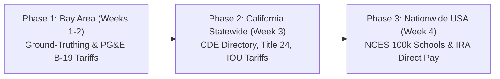

# SolarSchools USA: Automated Solar Canopy Feasibility & Federal IRA Direct Pay Modeling

[](https://opensource.org/licenses/MIT)
[](https://www.python.org/)
[](./CODE_OF_CONDUCT.md)
[](./test_pipeline.py)

**SVYCA Youth For Earth (Y4E) Hackathon @ Stanford Climate Week**  
**Showcase Date:** October 25, 2026 @ Stanford University  
**Author:** Pranav Balaji  
**Domain:** Clean Energy Transition, Civic Infrastructure Decarbonization, Federal Climate Finance  

---

## Project Overview

**SolarSchools USA** is an open-access, geospatial decision platform designed to empower public school districts across America to transform unshaded asphalt parking lots into clean energy solar photovoltaic (PV) canopies. 

By coupling high-resolution geospatial footprint extraction with the **U.S. Department of Energy / National Laboratory of the Rockies (NLR) PVWatts v8 solar physics engine** and **Section 6417 of the federal Inflation Reduction Act (IRA)**, SolarSchools USA models clean kilowatt-hour generation, utility bill savings, and the exact dollar amount of the **30% to 50% direct cash reimbursement checks** the IRS writes to tax-exempt public school districts.

---

## The 3-Phase Geographic Architecture



### Phase 1: San Francisco Bay Area (Proof-of-Concept & Local Validation)
* **Scope:** 9 Bay Area counties (Santa Clara, San Mateo, Alameda, Contra Costa).
* **Empirical Benchmarking:** Uses completed solar carport rollouts in the **Cupertino Union School District (CUSD 5.2 MW rollout)** and **Fremont Union High School District (FUHSD)** as ground-truth benchmarks to calibrate spatial packing density and solar harvest formulas against real commercial utility bills.
* **Testbeds:** Focuses on unshaded campuses across **Palo Alto Unified (Paly, Gunn)** and **San Jose Unified (Lincoln, SJCC)**.
* **Utility Tariffs:** Models **PG&E Commercial Schedule B-19 (Medium General Demand TOU)** and Schedule E-19 peak energy ($0.32–$0.42/kWh) and demand charges.

### Phase 2: California Statewide Expansion (Policy & Equity Overlays)
* **Scope:** All 58 California counties (~1,000 public school districts, ~10,000 public K-12 campuses).
* **State Directory:** Ingests the **California Department of Education (CDE) Public Schools Directory** (`pubschls.txt`).
* **Multi-Utility Modeling:** Expands to Southern California Edison (SCE), San Diego Gas & Electric (SDG&E), SMUD, and LADWP commercial rate schedules.
* **Policy & Equity:** Integrates **California SB 100** mandates and **CalEnviroScreen 4.0** Disadvantaged Community (DAC) equity overlays.

### Phase 3: Nationwide United States Expansion (National Scale & Federal Finance)
* **Scope:** All 50 U.S. states (~13,000 public school districts, ~100,000 public schools).
* **Federal Data:** Connects the **NCES National Public School Directory (~100,000 schools)** directly to OpenStreetMap parking footprints.
* **National Solar Irradiance:** Queries the **DOE / NLR PVWatts v8 API** (National Solar Radiation Database, NSRDB) across all U.S. climate zones.
* **State Tariffs:** Ingests **EIA Form 861** commercial electricity rates by state ($0.11/kWh in TX to $0.32/kWh in CA).
* **Federal IRA Direct Pay Calculator:** Models Section 6417 Elective Pay cash reimbursements:
  $$\text{IRA Reimbursement Rate} = 30\% \text{ (Base)} + 10\% \text{ (Energy Community Bonus)} + 10\% \text{ (Title I Low-Income Bonus)}$$

---

## Repository Documents

* **[`ProjectProposal.md`](./ProjectProposal.md):** The project proposal with problem background, equations, phased rollout, pitch outline, and official data citations (IRA 26 U.S.C. § 6417, NREL, NCES, EIA, EPA).
* **[`TechnicalBlueprint.md`](./TechnicalBlueprint.md):** The technical specifications, GIS algorithms, data dictionary, formulas, and code structure.
* **[`DetailedDesignDocument.md`](./DetailedDesignDocument.md):** Complete technical architecture design document with system flowcharts, detailed API sequence diagrams, mathematical derivations, and technical defense playbook.
* **[`StudentPitchGuide.md`](./StudentPitchGuide.md):** High-school presenter guide with 30-second elevator pitch, 3-minute hackathon pitch script, plain-English analogies, and top 12 judge Q&A defense answers.
* **[`ApiReference.md`](./ApiReference.md):** Detailed technical guide on external APIs (NLR PVWatts v8, Esri World Imagery, OpenStreetMap), JSON request/response schemas, fault tolerance, and judge Q&A talking points.

---

## Public Datasets & Data Sources

Every dataset used in SolarSchools USA is **100% public, verified, and actively maintained by U.S. Federal and California state agencies**:

| Dataset Name | Agency / Provider | Format | Exact Verified Download URL / Access Method |
| :--- | :--- | :--- | :--- |
| **NCES Public School Locations** | National Center for Education Statistics | CSV / GeoJSON (100k schools) | [NCES School Data Portal](https://nces.ed.gov/programs/edge/Geographic/SchoolLocations) or [ArcGIS Hub NCES Public Schools](https://hub.arcgis.com/datasets/nces::public-school-characteristics-current) |
| **NREL PVWatts v8 Solar Irradiance** | National Laboratory of the Rockies (U.S. DOE) | Free REST API JSON | [NLR Developer Portal](https://developer.nlr.gov/) (`https://developer.nlr.gov/api/pvwatts/v8.json?api_key=DEMO_KEY&lat=...`) |
| **OpenStreetMap Parking Polygons** | OpenStreetMap / Overpass | REST API JSON / XML | Direct API: `https://api.openstreetmap.org/api/0.6/map?bbox=...` or [Nominatim Geocoder](https://nominatim.openstreetmap.org/) |
| **Commercial Electricity Tariffs by State** | U.S. Energy Information Administration (EIA) | Tabular Excel / CSV | [EIA Form 861 Average Retail Price Table 5a](https://www.eia.gov/electricity/sales_revenue/xls/table5_a.xlsx) |
| **EPA eGRID GHG Emission Factors** | U.S. Environmental Protection Agency (EPA) | Tabular CSV | [EPA eGRID Data Explorer](https://www.epa.gov/egrid/data-explorer) |
| **IRA Energy Community Bonus Tracts** | U.S. Department of Energy | Shapefile / GeoJSON | [DOE Energy Communities Mapping Tool](https://energycommunities.gov/energy-community-tax-incentive/) |
| **California Public School Directory** | California Department of Education (CDE) | Tabular CSV / Text | [CDE Public Schools Database (pubschls.txt)](https://www.cde.ca.gov/ds/si/ds/documents/pubschls.txt) |

---

## Quick-Start Instructions

### 1. Set Up the Python Virtual Environment
```bash
python3 -m venv venv
source venv/bin/activate
pip install -r requirements.txt
```

### 2. Run the Automated Test Suite
Verify that all modules, the NLR PVWatts v8 API, and the IRA financial engine are operational:
```bash
python test_pipeline.py
```

### 3. Launch the Interactive Web Dashboard
Run the Streamlit application:
```bash
streamlit run app.py
```
Then open your browser to `http://localhost:8501`.

---

## Code Architecture & Core Modules

* **[`app.py`](./app.py):** Main Streamlit frontend featuring the 3-phase geographic selector, responsive sliders, satellite Folium canopy maps, Plotly 25-year cashflow pro formas, and one-click School Board Action Brief export.
* **[`core/data_ingest.py`](./core/data_ingest.py):** School directory covering all 3 phases (Bay Area, CA Statewide, USA Nationwide) with enrollments, utilities, retail tariffs, and OSM parking footprints.
* **[`core/solar_engine.py`](./core/solar_engine.py):** Connects to the active DOE/NLR PVWatts v8 endpoint (`developer.nlr.gov`), models monthly AC kilowatt-hours, and computes Level 2 EV charging synergies.
* **[`core/financial_model.py`](./core/financial_model.py):** Calculates IRA Section 6417 Elective Pay cash reimbursements (30% base + 10% bonuses), net out-of-pocket costs, avoided utility costs, and full 25-year degradation and escalation schedules.
* **[`core/report_generator.py`](./core/report_generator.py):** Generates the downloadable executive 1-page School Board Action Brief in GitHub-flavored Markdown with model resolution language and legal citations.
* **[`test_pipeline.py`](./test_pipeline.py):** Automated validation suite testing all modules against representative campuses across California, Texas, and beyond.

## Tentative Presentation Plan (Stanford Climate Week)

This is a working draft outline for the 3-minute hackathon presentation:

* **Minute 0:00 – 0:45: Background & Problem Context** — Briefly introduce the problem: public schools spend over $8B annually on electricity while unshaded asphalt parking lots sit idle in the sun. Mention the Inflation Reduction Act Section 6417 Direct Pay provision, which allows tax-exempt public schools to receive direct reimbursement checks from the federal government for clean energy installations.
* **Minute 0:45 – 2:00: Interactive Tool Walkthrough** — Walk through the interactive interface using representative school campuses. Demonstrate how parking lot area is measured, connect to solar irradiance calculations, and show estimated annual electricity savings, payback timelines, and the contrast between schools saving money and schools losing money.
* **Minute 2:00 – 2:40: Phased Architecture & Action Brief** — Discuss the project's phased progression, starting from Bay Area school districts (calibrated against local installations in Cupertino and Fremont Union) toward broader state and national modeling. Show the downloadable 1-page Action Brief designed for school board presentations.
* **Minute 2:40 – 3:00: Summary & Discussion** — Wrap up with key takeaways on making clean energy finance accessible to student climate advocates, and open the floor for judge Q&A.

---

## Open Source Governance & Community

SolarSchools USA is an open-source civic technology initiative. We welcome contributions from high school student clubs, parent-teacher associations, teachers, municipal leaders, and software engineers.

* **Contributing Guide:** Review [`CONTRIBUTING.md`](./CONTRIBUTING.md) for local development setup, how to submit new campuses, and pull request procedures.
* **Code of Conduct:** We adhere to the [Contributor Covenant v2.1](./CODE_OF_CONDUCT.md) to foster an inclusive and respectful community.
* **Security Policy:** To report security vulnerabilities responsibly, please review [`SECURITY.md`](./SECURITY.md).
* **Academic Citation:** If you cite or build upon this project in academic research or policy analysis, refer to [`CITATION.cff`](./CITATION.cff).

---

## Disclaimer & Regulatory Notice

SolarSchools USA is an educational and civic modeling platform developed to help students and community advocates estimate solar canopy potential and federal clean energy incentives. 

* The calculations produced by this tool are engineering simulations based on U.S. Department of Energy (NLR PVWatts v8) models, standard commercial tariffs, and statutory Inflation Reduction Act formulas.
* This tool does not constitute certified architectural, structural engineering, legal, or tax advisory services. 
* Actual project costs, solar generation, and utility interconnection terms will vary based on geotechnical soil samples, local utility interconnection tariffs, DSA (Division of the State Architect) structural approvals, and specific EPC contractor bids. School districts should engage licensed professional engineers (PE) and certified solar contractors prior to procurement.

---

## License

This project is licensed under the **MIT License**. See the [`LICENSE`](./LICENSE) file for complete details.

Copyright (c) 2026 Pranav Balaji and SolarSchools USA Contributors.

