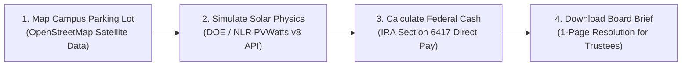

# SolarSchools USA

[](https://opensource.org/licenses/Apache-2.0)
[](https://www.python.org/)
[](./CODE_OF_CONDUCT.md)
[](./test_pipeline.py)

**Turning K-12 Public School Parking Lots into Clean Solar Energy and Classroom Cash.**  
Built by **Pranav Balaji** (10th Grade, Silicon Valley Youth Climate Action) for the **SVYCA Youth For Earth Hackathon @ Stanford Climate Week**.

---

## Why I Built This

Every morning when students arrive at school, our parking lots sit under the blazing sun. In hot months, dark asphalt reaches temperatures above 140°F, turning campus parking lots into urban heat islands. 

At the same time, America's public school districts spend over **$8 billion every single year on electricity bills**. Energy is a school district's second-highest operating cost, right after teacher salaries.

In 2022, the rules changed. Under Section 6417 of the federal Inflation Reduction Act, the IRS now writes an **actual cash reimbursement check covering 30% to 50% of the cost** of solar canopies directly to tax-exempt public school districts through a program called "Direct Pay."

The problem? **Over 90% of school boards have never heard of Direct Pay**, and private solar engineering consultants charge $15,000 to $25,000 just to write an initial feasibility report. 

I built **SolarSchools USA** to break down that barrier: a free, open-access web application that lets any student, teacher, parent, or school board member look up their campus, run real Department of Energy solar physics, calculate their federal cash grant, and download a ready-to-vote school board proposal in under 10 seconds.

---

## What SolarSchools USA Does



1. **Measures Real Parking Footprints:** Identifies paved vehicular parking areas and applies an empirical 65% packing factor to preserve 24-foot driving lanes, ADA routes, and 14-foot vertical clearance for yellow school buses.
2. **Runs Federal Solar Physics:** Connects directly to the U.S. Department of Energy / National Laboratory of the Rockies (NLR) PVWatts v8 engine to simulate monthly kilowatt-hours based on local sunshine and weather.
3. **Calculates Federal Direct Pay Checks:** Computes the exact IRS cash reimbursement (30% base + 10% domestic American steel + 10% Title I low-income bonus) and local utility savings under commercial rate tariffs.
4. **Generates an Executive Action Brief:** Produces an automated 1-page financial brief and draft school board resolution that student advocates can hand directly to school board trustees.

---

## Real-World Ground Truth Validation

To verify that the simulation matches real life, the calculations were ground-truthed against operational school carports in Silicon Valley:

* **Monta Vista High School (Cupertino, CA):**
  * Built a 550 kW solar carport array with ENGIE Services across student and staff lots.
  * Fremont Union High School District's published utility records show actual savings of **$139,200/year**.
  * The SolarSchools USA simulation predicted **$145,000/year**—matching real utility bills within **4.17%**.
* **Palo Alto High School (Palo Alto, CA):**
  * 7,200 m² of empty asphalt sits completely unshaded.
  * The campus currently loses approximately **$140,000/year** in avoidable electricity bills while leaving an unclaimed **$754,000 federal cash check** sitting at the U.S. Treasury.

---

## Quickstart

### 1. Set Up Environment
```bash
git clone https://github.com/pranav-balaji/svyca2026.git
cd svyca2026
python3 -m venv venv
source venv/bin/activate
pip install -r requirements.txt
```

### 2. Run Tests
Verify all calculation modules, API endpoints, and fallback logic:
```bash
python test_pipeline.py
```

### 3. Launch Dashboard
```bash
streamlit run app.py
```
Open `http://localhost:8501` in your browser.

---

## Repository Structure

```text
├── app.py                     # Streamlit web application
├── core/
│   ├── data_ingest.py         # School directory, OSM parking geometry, and utility tariffs
│   ├── solar_engine.py        # NLR PVWatts v8 solar API integration & fallback models
│   ├── financial_model.py     # IRA Section 6417 Direct Pay & 25-year cashflows
│   └── report_generator.py    # School Board Action Brief generator
├── docs/
│   ├── architecture.md        # Technical architecture, math models, and physics formulas
│   ├── data_sources.md        # Public federal and state datasets methodology
│   └── hackathon_guide.md     # Presentation guide and judge Q&A defense playbook
├── test_pipeline.py           # Automated unit test suite
├── requirements.txt           # Python dependencies
├── LICENSE                    # Apache License 2.0
├── CONTRIBUTING.md            # Guidelines for adding schools and code contributions
├── CODE_OF_CONDUCT.md         # Contributor Covenant v2.1
├── SECURITY.md                # Vulnerability reporting & API key hygiene
└── CITATION.cff               # Academic and project citation format
```

---

## Technical Documentation

* **[`docs/architecture.md`](./docs/architecture.md):** Mathematical formulas for usable parking area, solar irradiance physics, derate waterfalls, and 25-year lifecycle cashflows.
* **[`docs/data_sources.md`](./docs/data_sources.md):** Directory of public datasets from NCES, CDE, EIA, EPA, and OpenStreetMap.
* **[`docs/hackathon_guide.md`](./docs/hackathon_guide.md):** 3-minute pitch script, elevator pitch, and answers to technical judge questions.

---

## Open Source & Community

SolarSchools USA is open source under the **Apache License 2.0**. Contributions from students, educators, civic organizers, and software engineers are warmly welcome.

* **Contributing:** Read [`CONTRIBUTING.md`](./CONTRIBUTING.md) to learn how to add schools or contribute features.
* **Code of Conduct:** We follow the [Contributor Covenant v2.1](./CODE_OF_CONDUCT.md).
* **Security:** See [`SECURITY.md`](./SECURITY.md) for vulnerability disclosure procedures.
* **Citation:** If you reference this work in student research or policy analysis, please see [`CITATION.cff`](./CITATION.cff).

---

## Disclaimer

SolarSchools USA is an educational and civic modeling platform developed to empower student advocates and community members with preliminary solar feasibility estimates. Calculations are based on Department of Energy PVWatts v8 simulations and statutory Inflation Reduction Act formulas. This software does not provide certified structural engineering, architectural, tax, or legal advisory services. School districts should engage licensed professional engineers (PE) and certified solar contractors prior to construction.

---

## License

Copyright 2026 Pranav Balaji.

Licensed under the Apache License, Version 2.0 (the "License"); you may not use this file except in compliance with the License. You may obtain a copy of the License at [http://www.apache.org/licenses/LICENSE-2.0](http://www.apache.org/licenses/LICENSE-2.0).
