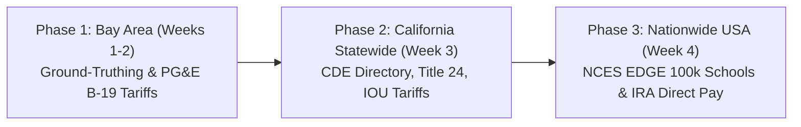

# SolarSchools USA: Automated Solar Canopy Feasibility & Federal IRA Direct Pay Modeling

**SVYCA Youth For Earth (Y4E) Hackathon @ Stanford Climate Week**  
**Showcase Date:** October 25, 2026 @ Stanford University  
**Author:** Pranav Balaji  
**Domain:** Clean Energy Transition, Civic Infrastructure Decarbonization, Federal Climate Finance  

---

## ☀️ Project Overview

**SolarSchools USA** is an open-access, geospatial decision platform designed to empower public school districts across America to transform unshaded asphalt parking lots into clean energy solar photovoltaic (PV) canopies. 

By coupling high-resolution geospatial footprint extraction with the **U.S. Department of Energy / National Laboratory of the Rockies (NLR) PVWatts v8 solar physics engine** and **Section 6417 of the federal Inflation Reduction Act (IRA)**, SolarSchools USA models clean kilowatt-hour generation, utility bill savings, and the exact dollar amount of the **30% to 50% direct cash reimbursement checks** the IRS writes to tax-exempt public school districts.

---

## 🗺️ The 3-Phase Geographic Architecture



### Phase 1: San Francisco Bay Area (Proof-of-Concept & Local Validation)
* **Scope:** 9 Bay Area counties (Santa Clara, San Mateo, Alameda, Contra Costa).
* **Empirical Benchmarking:** Uses completed solar carport rollouts in the **Cupertino Union School District (CUSD 5.2 MW rollout)** and **Fremont Union High School District (FUHSD)** as ground-truth benchmarks to calibrate spatial packing density and solar harvest formulas against real commercial utility bills.
* **Testbeds:** Focuses on unshaded campuses across **Palo Alto Unified (Paly, Gunn)** and **San Jose Unified (Lincoln, SJCC)**.
* **Utility Tariffs:** Models **PG&E Commercial Schedule B-19 (Medium General Demand TOU)** and Schedule E-19 peak energy ($0.32–$0.42/kWh) and demand charges.

### Phase 2: California Statewide Expansion (Policy & Equity Overlays)
* **Scope:** All 58 California counties (~1,000 public school districts, ~10,000 public K-12 campuses).
* **State Directory:** Ingests the **California Department of Education (CDE) Public Schools Directory** (`pubschls.txt`).
* **Multi-Utility Modeling:** Expands to Southern California Edison (SCE), San Diego Gas & Electric (SDG&E), SMUD, and LADWP commercial rate schedules.
* **Policy & Equity:** Integrates **California SB 100** mandates and **CalEnviroScreen 4.0** Disadvantaged Community (DAC) equity overlays.

### Phase 3: Nationwide United States Expansion (National Scale & Federal Finance)
* **Scope:** All 50 U.S. states (~13,000 public school districts, ~100,000 public schools).
* **Federal Data:** Connects the **NCES EDGE database (~100,000 schools)** directly to OpenStreetMap parking footprints.
* **National Solar Irradiance:** Queries the **DOE / NLR PVWatts v8 API** (National Solar Radiation Database, NSRDB) across all U.S. climate zones.
* **State Tariffs:** Ingests **EIA Form 861** commercial electricity rates by state ($0.11/kWh in TX to $0.32/kWh in CA).
* **Federal IRA Direct Pay Calculator:** Models Section 6417 Elective Pay cash reimbursements:
  $$\text{IRA Reimbursement Rate} = 30\% \text{ (Base)} + 10\% \text{ (Energy Community Bonus)} + 10\% \text{ (Title I Low-Income Bonus)}$$

---

## 📂 Repository Documents

* **[`PROJECT_PROPOSAL_SOLARSCHOOLS.md`](./PROJECT_PROPOSAL_SOLARSCHOOLS.md):** The complete, publication-ready project proposal with executive summary, mathematical formulas, 4-week execution roadmap, minute-by-minute pitch script, and formal statutory and academic citations (26 U.S.C. § 6417, NREL, NCES, EIA, EPA, CPUC).
* **[`SOLARSCHOOLS_TECHNICAL_BLUEPRINT.md`](./SOLARSCHOOLS_TECHNICAL_BLUEPRINT.md):** The comprehensive technical specification, spatial algorithms, data dictionary, error matrices, and production Python code snippets.

---

## 📊 Reliable & Verified Public Datasets

Every dataset used in SolarSchools USA is **100% public, verified, and actively maintained by U.S. Federal and California state agencies**:

| Dataset Name | Agency / Provider | Format | Exact Verified Download URL / Access Method |
| :--- | :--- | :--- | :--- |
| **NCES EDGE Public School Locations** | National Center for Education Statistics | CSV / GeoJSON (100k schools) | [NCES EDGE School Data Portal](https://nces.ed.gov/programs/edge/Geographic/SchoolLocations) or [ArcGIS Hub NCES Public Schools](https://hub.arcgis.com/datasets/nces::public-school-characteristics-current) |
| **NREL PVWatts v8 Solar Irradiance** | National Laboratory of the Rockies (U.S. DOE) | Free REST API JSON | [NLR Developer Portal](https://developer.nlr.gov/) (`https://developer.nlr.gov/api/pvwatts/v8.json?api_key=DEMO_KEY&lat=...`) |
| **OpenStreetMap Parking Polygons** | OpenStreetMap / Overpass | REST API JSON / XML | Direct API: `https://api.openstreetmap.org/api/0.6/map?bbox=...` or [Nominatim Geocoder](https://nominatim.openstreetmap.org/) |
| **Commercial Electricity Tariffs by State** | U.S. Energy Information Administration (EIA) | Tabular Excel / CSV | [EIA Form 861 Average Retail Price Table 5a](https://www.eia.gov/electricity/sales_revenue/xls/table5_a.xlsx) |
| **EPA eGRID GHG Emission Factors** | U.S. Environmental Protection Agency (EPA) | Tabular CSV | [EPA eGRID Data Explorer](https://www.epa.gov/egrid/data-explorer) |
| **IRA Energy Community Bonus Tracts** | U.S. Department of Energy | Shapefile / GeoJSON | [DOE Energy Communities Mapping Tool](https://energycommunities.gov/energy-community-tax-incentive/) |
| **California Public School Directory** | California Department of Education (CDE) | Tabular CSV / Text | [CDE Public Schools Database (pubschls.txt)](https://www.cde.ca.gov/ds/si/ds/documents/pubschls.txt) |

---

## 🛠️ Quick-Start Instructions

### 1. Set Up the Python Virtual Environment
```bash
python3 -m venv venv
source venv/bin/activate
pip install geopandas shapely requests pandas folium streamlit streamlit-folium matplotlib
```

### 2. Run the Interactive Web Prototype
Run the Streamlit application located in Section 4 of [`SOLARSCHOOLS_TECHNICAL_BLUEPRINT.md`](./SOLARSCHOOLS_TECHNICAL_BLUEPRINT.md):
```bash
streamlit run app.py
```

---

## 🏆 Stanford Climate Week Pitch Strategy (October 25, 2026)

* **Minute 0:00 – 0:45: The Problem & The Federal Catalyst** — America's schools spend $8B on power. Cupertino already built solar carports, but 100,000 schools across America have no budget for consultants. The IRA now pays 30%–50% in direct cash checks from the IRS.
* **Minute 0:45 – 2:15: Live Interactive Tool Demo** — Select a school anywhere in the country (Texas, Arizona, Florida, Ohio). The app auto-extracts the lot, calls NREL solar physics, and reveals the $600k+ IRS check and $90k/yr in electricity savings.
* **Minute 2:15 – 3:00: Phase Progression & Action Brief Generator** — Highlight the 3 phases (Bay Area $\rightarrow$ California Statewide $\rightarrow$ Nationwide USA) and generate a 1-page School Board Action Brief.
* **Minute 3:00 – 3:30: Closing & Q&A Transition** — Democratizing clean energy finance for the next generation.
